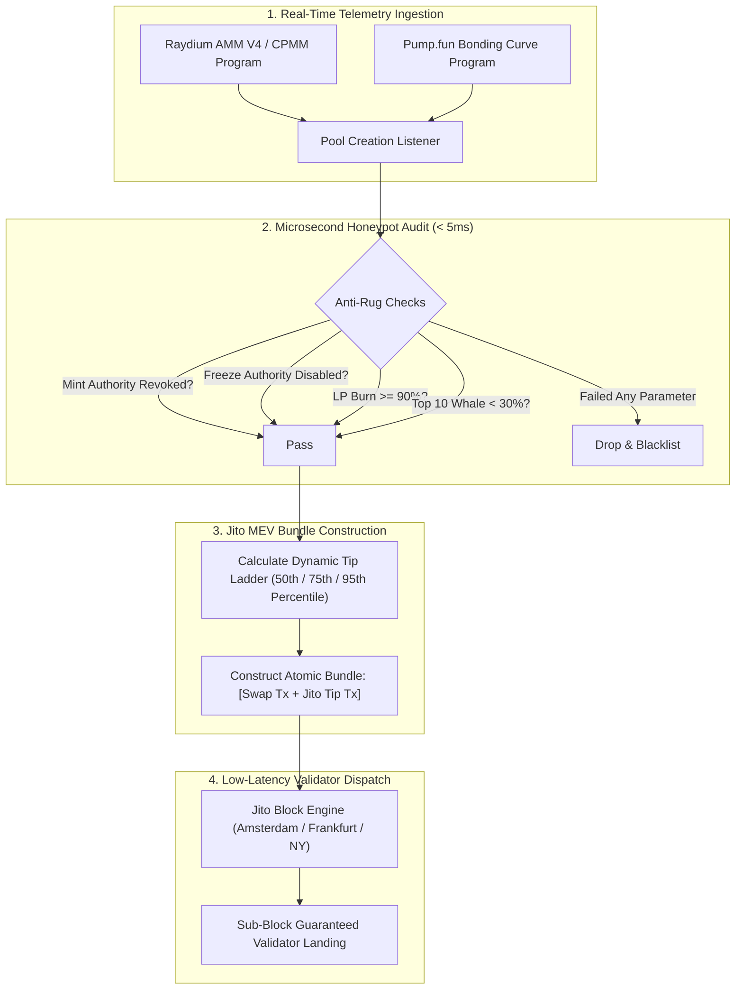

# ⚡ Solana-Jito-Sniper-Engine: Sub-Millisecond Token Sniper & MEV Bundle Executor

[](https://python.org)
[](https://solana.com)
[](https://jito.wtf)
[](https://docker.com)
[](https://github.com)
[](https://opensource.org/licenses/MIT)

> An institutional low-latency token sniping and swap execution framework engineered for the **Solana** blockchain. Integrates directly with the **Jito MEV Block Engine** to bundle atomic transactions, bypass public mempool congestion, eliminate sandwich / front-running attacks, and guarantee sub-block inclusion on **Raydium AMM V4**, **Raydium CPMM**, and **Pump.fun**.

---

### 💼 Need Custom Solana Snipers, Jito MEV Bundles, or Trading Bots?
I engineer high-performance trading software, low-latency blockchain infrastructure, and quantitative execution engines for prop traders, private syndicates, and crypto funds.
* 💬 **Telegram:** [@JanzebBlockdev](https://t.me/JanzebBlockdev)
* 💼 **Fiverr Profile:** [jahanzaib313110 (Fiverr Pro Specialist)](https://www.fiverr.com/jahanzaib313110)
* 🌐 **GitHub Portfolio:** [@jahanzaib-codes](https://github.com/jahanzaib-codes)

---

## 🏛️ System Architecture



---

## ✨ Key Architectural Highlights

* **Jito MEV Atomic Bundles:** Transactions are submitted directly to Jito-Solana validators via private block engines. Swaps are executed atomically with zero public mempool exposure, completely immunizing your orders against toxic sandwich and MEV front-running bots.
* **Sub-5ms Honeypot & Rug Filter:** Microsecond bytecode parsing evaluates target token parameters prior to transaction submission:
  * Mint authority verification (rejects tokens capable of inflationary supply minting).
  * Freeze authority verification (rejects honeypots capable of freezing buyer balances).
  * Liquidity burn / lock verification (requires $\ge 90\%$ burned LP).
* **Multi-DEX Protocol Coverage:** Out-of-the-box decoders for Raydium AMM V4, Raydium Concentrated Pool Market Maker (CPMM), and Pump.fun bonding curves.
* **Dynamic Tip Ladder:** Automatically rotates through official Jito tip accounts and adjusts validator tips according to real-time network priority demand (50th, 75th, 95th percentiles).

---

## 🚀 Quickstart Guide

### 1. Installation
```bash
git clone https://github.com/jahanzaib-codes/Solana-Jito-Sniper-Engine.git
cd Solana-Jito-Sniper-Engine

# Create virtual environment
python -m venv venv
source venv/bin/activate  # On Windows: venv\Scripts\activate

# Install dependencies
pip install -r requirements.txt
```

### 2. Run Jito MEV Snipe Simulation
Test the end-to-end event detection, honeypot safety audit, and simulated Jito bundle execution in dry-run mode:
```bash
python cli.py demo
```

### 3. Audit Any Token Mint
Run the on-chain security check on any target token address:
```bash
python cli.py audit --mint SolAlpha111111111111111111111111111111111111
```

### 4. Live Daemon Execution
Configure your `.env` parameters:
```bash
cp .env.example .env
# Edit SOLANA_RPC_URL and PRIVATE_KEY_BASE58 in .env

# Run daemon
python main.py

# Or via Docker
docker compose up -d
```

---

## 🖥️ Terminal Execution Preview

```text
⚡ Running Solana Jito MEV Sniper Simulation Demo

⚡ New Pool Detected: [RAYDIUM_AMM_V4] Mint: SolAlpha111111111111111111111111111111111111 | Liquidity: 25.0 SOL
🛡️ Token Passed Security Checks in 1.68ms (LP 100% Burned, Mint/Freeze Revoked)
📦 Constructing Jito Bundle with 0.0005 SOL tip (500000 lamports) to DfXygSm4jCyN...
🎯 BUNDLE CONFIRMED (SIMULATED)! ID: bundle_1794382011721_5256 | Slot: 312450123 | Total Latency: 3.81ms
```

---

## 🛡️ License
Distributed under the **MIT License**. See [`LICENSE`](LICENSE) for complete details.
